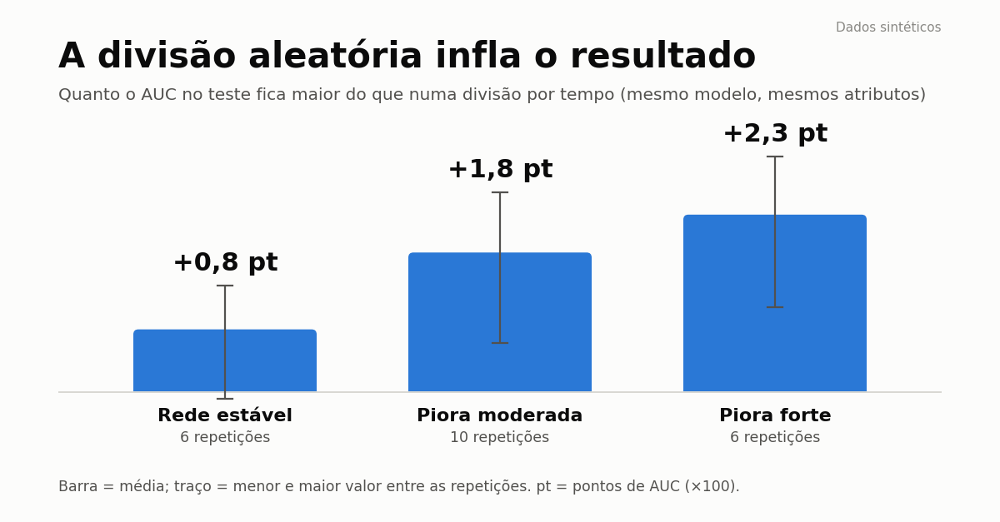

# Vazamento temporal: quanto a divisão aleatória infla o resultado

Experimento reproduzível, com **dados 100% sintéticos**, sobre um erro comum em previsão com séries temporais:
dividir treino e teste de forma aleatória quando o alvo de cada linha olha para o futuro.



## A pergunta

Num painel de 400 "células" com um indicador de qualidade diário, o modelo responde:
**"a média dos próximos 7 dias vai ficar abaixo da meta?"** (cerca de 23% das linhas são positivas).
Os atributos olham 14 dias para trás (média, mínimo, desvio, último valor, tendência, dias ruins).

O modelo (`HistGradientBoostingClassifier`) e os atributos são **os mesmos** nas três divisões:

| Divisão | Como funciona |
|---|---|
| Aleatória | sorteia linhas para treino e teste |
| Por tempo, sem folga | treina no passado, testa nos últimos 25% dos dias |
| Por tempo, com folga | igual, mas descarta do treino os 7 dias antes do corte, para nenhum alvo de treino enxergar o teste |

## Resultado (AUC no teste, 10 repetições, cenário base)

| Divisão | AUC (média ± desvio) |
|---|---|
| Aleatória | 0,877 ± 0,004 |
| Por tempo, sem folga | 0,860 ± 0,005 |
| Por tempo, com folga | 0,859 ± 0,004 |

**Sensibilidade.** O quanto a divisão aleatória infla o AUC (aleatória − por tempo com folga), conforme a rede piora ao longo do tempo:

| Piora da rede ("deriva") | Inflação do AUC | Repetições |
|---|---|---|
| Nenhuma (rede estável) | +0,008 | 6 |
| Moderada | +0,018 | 10 |
| Forte | +0,023 | 6 |

## O que isso mostra, e o que não mostra

- A divisão aleatória **superestima** o desempenho, e a diferença **cresce** quando os dados mudam com o tempo.
- O efeito aqui é **pequeno em valor absoluto** (menos de 3 pontos de AUC). Num cenário com mais persistência por célula, janelas mais longas
  ou mudança de regime mais forte, ele pode ser maior; não testei isso.
- A **folga de 7 dias não mudou o resultado** neste cenário (0,860 contra 0,859). O que pesou foi dividir por tempo, e não por sorteio.
  Mantenho a folga como seguro barato, mas não é isso que explica a diferença aqui.
- A diferença entre "piora moderada" e "piora forte" está dentro do ruído das repetições (veja o desvio no gráfico); a tendência de crescimento, de rede estável para piora forte, é a parte consistente.
- Dados sintéticos mostram o mecanismo, não o tamanho do efeito em dados reais.

## Como rodar

```bash
pip install -r requirements.txt
python vazamento_temporal.py    # imprime as tabelas e grava resultados.csv (cerca de 5 minutos)
python grafico.py               # gera grafico_vazamento.png
```

Tudo é determinístico: as repetições usam sementes de 0 a 9 (0 a 5 na sensibilidade).
